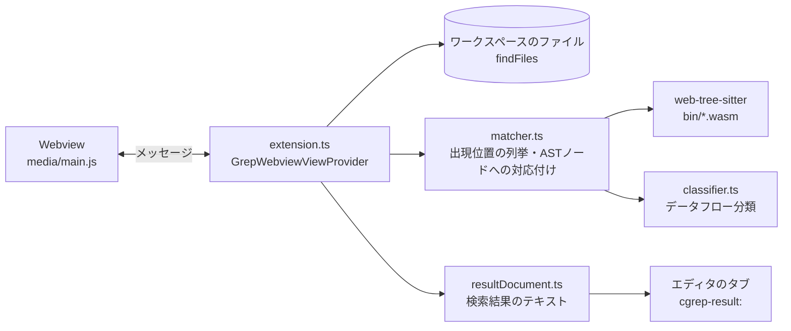
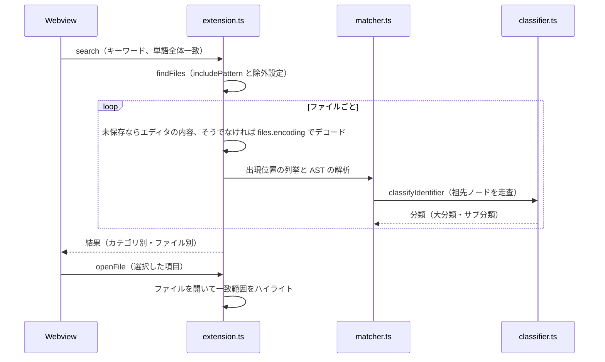

# 設計

## 全体構成

分類の流れ（出現位置の列挙 → AST ノードへの対応付け → 祖先ノードの走査による分類）は、[spec.md の分類ルール](spec.md#分類ルール) を参照。

## ディレクトリ構成と各モジュールの責務

| パス | 責務 |
|---|---|
| `src/extension.ts` | 起動、コマンドの登録、Webview ビューのプロバイダ（`GrepWebviewViewProvider`）。ファイルの列挙、文字コードのデコード、検索の実行、ハイライトとジャンプ |
| `src/matcher.ts` | テキスト検索による出現位置の列挙（部分一致・単語全体一致）と、AST ノードへの対応付け。`vscode` は型としてのみ参照する |
| `src/classifier.ts` | 祖先ノードを辿るデータフロー分類（`classifyIdentifier`）とサブ分類 |
| `src/resultDocument.ts` | 検索結果をテキストにするドキュメントプロバイダ（スキーム `cgrep-result`）と、結果行から元の位置への対応 |
| `src/types.ts` | 型定義と、カテゴリ・サブ分類の定義 |
| `media/webview.html`、`main.js`、`main.css` | Webview の画面（CSP: `default-src 'none'`、スクリプトは nonce 付きのみ） |
| `media/icon.svg` | アクティビティバーのアイコン |
| `bin/tree-sitter.wasm`、`bin/tree-sitter-c.wasm` | tree-sitter 本体と C 言語パーサー |
| `test/` | `node:test` によるテスト。`test_data/` はテスト用の C ソース |

## データの流れ

- 検索中は、通知領域に「C言語ファイルを分析中...」を表示する。解析に失敗したファイルは飛ばす。
- 検索結果のタブ（`cgrep-result:C-Grep 検索結果.cgrep`）は常に同じ URI で、再検索のたびに内容を更新する。括弧の色分けを避けるため、専用の言語 ID（`cgrep-result`）として扱う。

## 外部依存

| 依存 | 用途 |
|---|---|
| `web-tree-sitter`（実行時の唯一の依存） | C ソースの構文解析（[ADR 0002](adr/0002-use-tree-sitter-for-parsing.md)） |
| `bin/*.wasm` | tree-sitter 本体と C 言語パーサー。バイナリとして直接読み込む（[ADR 0003](adr/0003-load-wasm-as-binary.md)） |
| 開発用: TypeScript、`@types/vscode`、`@types/node` | ビルドと型 |
