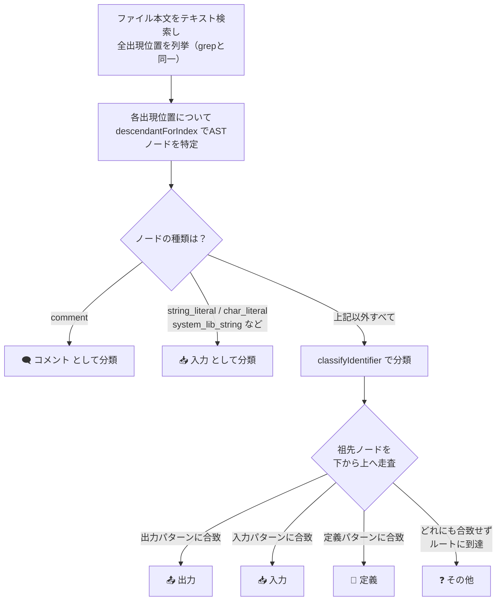

# 仕様

## 目的とスコープ

C言語のソースコードをキーワード検索（grep）し、一致箇所を、構文解析（AST）でデータフローの観点から分類して表示する VS Code 拡張機能。「この変数はどこで書き換えられているのか」を短時間で把握するためのもの。

### やること
- ワークスペース内の C ソース（既定は `**/*.{c,h}`）を検索し、一致箇所を「入力」「出力」「定義」「コメント」「その他」に分類して表示する。
- 一致件数は、VS Code 標準の検索と同じ方法（テキスト検索）で数え、分類できない箇所も「その他」として必ず表示する。

### やらないこと
- C 以外の言語の解析。
- 一致箇所の置換・編集。

## 機能一覧

### 分類カテゴリ

| カテゴリ | 意味 | 例 | 色 |
|---|---|---|---|
| 📥 入力 | 値が読み取られている箇所（参照） | `x = hoge;` / `func(hoge)` / `if (hoge > 0)` | 🔵 青 |
| 📤 出力 | 値が書き込まれている箇所（代入） | `hoge = 10;` / `hoge++;` / `scanf("%d", &hoge)` | 🔴 赤 |
| 📝 定義 | 変数・関数・型などが宣言・定義されている箇所 | `int hoge;` / `#define hoge 1` / `void hoge(void) {}` | 🟢 緑 |
| 🗨️ コメント | コメント内に出現している箇所 | `// hogeの説明` | ⚪ 灰 |
| ❓ その他 | 上記のいずれにも該当しない箇所 | — | 🟠 橙 |

判定の規則は、下記「分類ルール」を参照。

### 検索
- サイドバー（アクティビティバーの「C-Grep Classifier」）の検索窓にキーワードを入力し、Enter で検索する。
- エディタで単語を選択して `Alt + Q`（またはコマンド「C-Grep: データフロー分類検索を実行」）を実行すると、その単語で検索する。何も選択していないときは、サイドバーにフォーカスを移す。
- 検索窓の右のトグルで、部分一致と単語全体一致を切り替える（判定は下記「補足: 検索モード」）。
- 配列アクセス（`hoge[0]`）、構造体メンバアクセス（`hoge.member`、`ptr->member`）、アドレス渡し（`&hoge`）を区別して分類する。

### 結果の表示（サイドバー）
- カテゴリごと、さらにファイルごとに、アコーディオンでグループ化して表示する。
- 各一致箇所が属する関数名を、行番号の隣に表示する（設定 `cGrepClassifier.showEnclosingFunction`）。
- 設定 `cGrepClassifier.detailLevel` を `detailed` にすると、大分類の下にサブ分類を表示する（下記「フェーズ3: サブ分類」）。
- 項目をクリック、または `↑` `↓` キーで選択すると、該当ファイルを開き、一致した文字列の範囲をテーマ色に連動した色でハイライトする。選択中もフォーカスはサイドバーに残り、Enter でエディタにフォーカスを移す。

### 関数名一覧モード
- 検索窓の「関数名一覧を表示」トグル、またはコマンド「C-Grep: 関数名一覧の表示を切り替え」で、一致箇所の代わりに、キーワードが出現する関数名だけを一覧表示する（例: `■ 出力 (6件 / 1関数)`）。
- 関数名を選ぶと、その関数内の最初の一致箇所へジャンプする。
- 切り替えはサイドバーとエディタの一覧の両方に同時に反映し、再検索はしない。
- 関数に属さない一致（グローバル変数の宣言・マクロ定義など）は、一覧に現れない（件数には含まれる）。

### 検索結果のエディタ表示
- 検索窓の右の「検索結果をエディタで開く」ボタン、またはコマンド「C-Grep: 検索結果をエディタで開く」で、VS Code の「検索エディター」と同様に、結果をエディタのタブにテキストで表示する。
- 結果行で Enter（コマンド「C-Grep: カーソル行の一致箇所を開く」）または Ctrl + クリックで、該当箇所へジャンプする。
- 読み取り専用。タブは常に同じもの（`cgrep-result:C-Grep 検索結果.cgrep`）で、再検索すると内容が更新される。テキストなので、選択・コピー・保存ができる。

### コマンド

| コマンド | ID | 既定のキー |
|---|---|---|
| C-Grep: データフロー分類検索を実行 | `c-grep-classifier.search` | `Alt + Q`（エディタにフォーカスがあるとき） |
| C-Grep: 検索結果をエディタで開く | `c-grep-classifier.showResultsInEditor` | — |
| C-Grep: カーソル行の一致箇所を開く | `c-grep-classifier.openResultAtCursor` | Enter（検索結果のタブで） |
| C-Grep: 関数名一覧の表示を切り替え | `c-grep-classifier.toggleFunctionSummary` | — |

## 入出力とデータ形式

- 入力: ワークスペース内のファイル。対象と除外は設定で決める（[configuration.md](configuration.md)）。
- 文字コードは、VS Code の `files.encoding` 設定に従ってデコードする（Shift_JIS、EUC-JP などにも対応）。
- 編集中で未保存のファイルは、ディスクではなくエディタ上の内容を解析する。
- 出力: サイドバーの一覧と、検索結果のテキスト（エディタのタブ）。ファイルへの書き込みはしない。

検索結果のテキストの形式（例）:

```
C-Grep Classifier   検索: "hoge"   (部分一致)
21 件の一致 / 1 ファイル

Enter または Ctrl+クリックで該当箇所へジャンプします。

■ 出力 (6)

  test_data/test.c (6)
    31:  main()  hoge_array[0] = 10;
    32:  main()  hoge_data.id = 1;
```

## 制約条件

- VS Code 1.75.0 以降。
- 構文解析は tree-sitter の C 文法で行う。マクロで構文が崩れる箇所は、解析結果が `ERROR` ノードになりうる（一部は「分類ルール」の救済パターンで扱う）。

## エラー時の挙動

| 状況 | 挙動 |
|---|---|
| ワークスペースが開かれていない | 「ワークスペースが開かれていません。」と通知する |
| パーサー（WASM）の初期化に失敗 | 「Parserの初期化に失敗しました。WASMファイルが正しく配置されているか確認してください」とエラー通知する |
| 一部のファイルの解析に失敗 | そのファイルを飛ばして検索を続ける（エラーは開発者コンソールに出力） |
| 結果のファイルを開けない | 「ファイルを開くことができませんでした」とエラー通知する |
| 検索前に「検索結果をエディタで開く」を実行 | 「先に検索を実行してください。」と通知する |

## 分類ルール

検索キーワードの出現箇所を、どのように分類するかを定める。

### 分類の全体フロー



> [!IMPORTANT]
> 分類の優先順位は **出力 → 入力 → 定義 → その他** の順である。祖先ノードを下から上へ辿り、最初に合致したパターンで分類が確定する。


### フェーズ1: 出現位置の列挙

検索対象の特定は **テキスト起点** で行う。まずファイル本文に対して純粋なテキスト検索を行い、キーワードの出現位置をすべて列挙する。

- **部分一致モード**: `indexOf` による走査
- **単語全体一致モード**: 前後が単語文字（Unicode 対応。[検索モード](#補足-検索モード) を参照）でない位置だけを探す正規表現による走査

> [!IMPORTANT]
> この処理は VS Code 標準の検索（grep）と同一である。そのため **検索結果の件数は標準検索のヒット件数と必ず一致する**。分類できない箇所が結果から消えることはなく、「その他」に分類される。

#### 位置からASTノードへの変換

列挙した各出現位置について、`descendantForIndex()` により **その位置を含む最小のASTノード** を特定し、フェーズ2の分類に渡す。

```c
int temp = hoge_array[0];
//         ^^^^                    位置を列挙
//         └→ identifier "hoge_array" を特定 → 分類へ
```

#### ノード種別による確定分類

特定したノード（およびその祖先）が以下の種別に該当する場合、その時点でカテゴリが確定する。

| ノード種別 | 分類 | 例 |
|---|---|---|
| `comment` | 🗨️ コメント | `// hogeの説明`、`/* hoge */` |
| `string_literal` / `string_content` | 📥 入力 | `printf("hogeの値")` |
| `char_literal` / `character` | 📥 入力 | `c = 'h';` |
| `escape_sequence` | 📥 入力 | `"\then"` |
| `system_lib_string` | 📥 入力 | `#include <hoge.h>` |

上記以外のノードは、すべてフェーズ2の `classifyIdentifier` によってコンテキストから分類される。識別子・型名・数値定数・ラベルなど、ノードの種類による区別はない。

> [!NOTE]
> 出現位置1件につき結果も必ず1件である。同一行に複数回出現する場合や、コメントと識別子が同居する場合でも、重複や取りこぼしは原理的に発生しない。

#### ハイライト範囲

選択・ハイライトされるのは **一致した文字列そのもの** である。部分一致で `hoge` が `hoge_max` にヒットした場合、`hoge` の部分のみが選択される（VS Code 標準検索と同じ挙動）。


### フェーズ2: データフロー分類の詳細 (`classifyIdentifier`)

フェーズ1で抽出されたノード（`comment` と `string_literal` を除く）は、`classifyIdentifier` 関数によって **祖先ノードを下から上へ辿る** ことでカテゴリが決定される。

#### 2.1 出力（📤 書き込み）

出力として分類される条件は以下の3パターンである。**最も優先度が高い**判定である。


##### パターン1: 代入式の左辺 (`assignment_expression` の `left`)

```c
hoge = 10;           // hoge → 出力
hoge += value;       // hoge → 出力（複合代入も含む）
s.member = 5;        // s.member → 出力
```

検索キーワードが代入演算子（`=`, `+=`, `-=`, `*=`, `/=`, `%=`, `<<=`, `>>=`, `&=`, `|=`, `^=`）の **左辺** に位置している場合。

> [!IMPORTANT]
> ただし **配列添字（`subscript_expression` の index 部分）に位置する場合は除外** し、「入力」として扱う。書き込まれるのは配列本体であり、添字は読み取られているためである。
>
> ```c
> hoge[i] = 0;        // hoge → 出力（配列本体への書き込み）
> arr[hoge] = 0;      // hoge → 入力（添字としての読み取り）
> arr[hoge + 1] = 0;  // hoge → 入力
> hoge[hoge] = 0;     // 左の hoge → 出力 / 右の hoge → 入力
> ```


##### パターン2: インクリメント/デクリメント (`update_expression`)

```c
hoge++;              // hoge → 出力
--hoge;              // hoge → 出力
```

`++` または `--` 演算子の対象となっている場合。前置・後置の両方が該当する。


##### パターン3: アドレス取得演算子 (`pointer_expression` で `&`)

```c
scanf("%d", &hoge);  // hoge → 出力
func(&hoge);         // hoge → 出力
```

`&` 演算子でアドレスが取得されている場合。関数にポインタとして渡される場面で、変数の値が書き換えられる可能性があるため「出力」として扱う。

> [!NOTE]
> ポインタのデリファレンス（`*ptr`）はこのパターンには該当しない。`*` 演算子の場合は出力とは判定されず、後続の入力や定義の判定に進む。


#### 2.2 入力（📥 読み取り・参照）

出力パターンに合致しなかった場合、入力として分類される条件が評価される。


##### パターン1: 代入式の右辺 (`assignment_expression` の `right`)

```c
result = hoge;       // hoge → 入力
result = hoge + 1;   // hoge → 入力
```

代入演算子の **右辺** に位置している場合。値が読み取られていることを意味する。


##### パターン2: 初期化式の値部分 (`init_declarator` の `value`)

```c
int result = hoge;   // hoge → 入力
int arr[] = {hoge};  // hoge → 入力
```

変数宣言時の初期化値として参照されている場合。


##### パターン3: 条件式内 (`if`, `while`, `for` の `condition`)

```c
if (hoge > 0) { }       // hoge → 入力
while (hoge != 0) { }   // hoge → 入力
for (i = 0; i < hoge; i++) { }  // hoge → 入力
```

制御構文の条件部分で値が評価（読み取り）されている場合。


##### パターン4: 関数引数 (`argument_list`)

```c
printf("%d", hoge);  // hoge → 入力
func(hoge, 10);      // hoge → 入力
```

関数呼び出しの引数として渡されている場合。

> [!NOTE]
> `&hoge` のようにアドレスが渡されている場合は、先に出力パターン3（アドレス取得）で捕捉されるため、ここには到達しない。


##### パターン5: 二項演算式 (`binary_expression`)

```c
int x = a + hoge;    // hoge → 入力
if (a == hoge) { }   // hoge → 入力（条件式内の判定より先にヒットすることもある）
```

加減乗除や比較演算の一部として値が参照されている場合。


##### パターン6: return文 (`return_statement`)

```c
return hoge;         // hoge → 入力
return hoge + 1;     // hoge → 入力
```

`return` で値が返される際に参照されている場合。


##### パターン7: switch/case文 (`switch_statement`, `case_statement`)

```c
switch (hoge) { }    // hoge → 入力
case hoge: break;    // hoge → 入力
```


##### パターン8: 宣言・定義の中で値として参照されている箇所

宣言や定義の一部であっても、**宣言されている対象そのものではなく、値として読まれている**箇所は「入力」として扱う。

```c
int buf[hoge];              // hoge → 入力（配列の大きさ）
enum e { X = hoge };        // hoge → 入力（enum定数の初期値）
#define MAX (hoge + 1)      // hoge → 入力（マクロの置き換え値）
```

| 箇所 | 対象ノード | 判定 |
|---|---|---|
| 配列サイズ | `array_declarator` の `size` | 入力 |
| enum定数の初期値 | `enumerator` の `value` | 入力 |
| マクロ定義の右辺 | `preproc_def` / `preproc_function_def` の `value` | 入力 |

> [!NOTE]
> マクロの右辺は `preproc_arg` という1つのトークンとして解析されるため、内部の構文（条件式なのか演算なのか）までは判別できない。そのためサブ分類は一律「参照」となる。

`switch` の評価対象や `case` のラベル値として参照されている場合。


#### 2.3 定義（📝 宣言・定義）

出力にも入力にも合致しなかった場合、定義として分類される条件が評価される。


##### パターン1: typedef の宣言子 (`type_definition` の `declarator`)

```c
typedef int hoge;            // hoge → 定義
typedef struct { } hoge_t;   // hoge_t → 定義
```

`typedef` で新しい型名が定義されている場合。


##### パターン2: enum定数メンバー (`enumerator`)

```c
enum Color { RED, GREEN, BLUE };
//           ^^^  ^^^^^  ^^^^  すべて → 定義
```

`enum` の各定数名として定義されている場合。**`name` フィールド（定数名）のみが対象**である。

> [!IMPORTANT]
> 初期値部分（`value` フィールド）は定義ではなく参照のため、「入力（初期化値）」として扱う。
>
> ```c
> enum e { X = A };   // X → 定義（enum定数） / A → 入力（初期化値）
> ```


##### パターン3: マクロ引数 (`preproc_params`)

```c
#define FUNC(hoge, arg2) ((hoge) + (arg2))
//           ^^^^  ^^^^  マクロ引数 → 定義
```

関数マクロのパラメータとして定義されている場合。


##### パターン4: 変数宣言 (`declaration`, `parameter_declaration`)

```c
int hoge;                    // hoge → 定義
int hoge = 10;               // hoge → 定義（※初期化値の中のhogeは入力）
void func(int hoge) { }     // hoge → 定義（関数引数）
extern int hoge;             // hoge → 定義
static int hoge;             // hoge → 定義
```

変数やパラメータが宣言されている場合。ただし、型名部分（`int`, `char` など）に検索キーワードが含まれる場合は除外される。

> [!IMPORTANT]
> **配列のサイズ部分（`array_declarator` の size 部分）は除外**し、「入力」として扱う。宣言されているのは配列自体であり、サイズは大きさとして値が読まれているためである。
>
> ```c
> int hoge[A];        // hoge → 定義 / A → 入力（参照）
> int hoge[A] = {0};  // hoge → 定義 / A → 入力（参照）
> int hoge[A][B];     // A, B とも 入力（参照）
> int hoge[hoge];     // 配列名は 定義 / サイズは 入力
> ```
>
> この扱いは、構造体メンバー宣言・関数パラメータ宣言・初期化付き宣言にも同様に適用される。添字としての読み出し（`x = arr[A];`）と同じ分類になる。

> [!IMPORTANT]
> `int hoge = hoge_init;` のような初期化付き宣言では、左辺の `hoge` は「定義」、右辺の `hoge_init` は「入力」として、それぞれ正しく分離される。


##### パターン5: 初期化宣言子の宣言部分 (`init_declarator` の `declarator`)

```c
int hoge = 10;               // hoge → 定義（declarator部分）
```

`int hoge = 10;` において、`hoge` は `init_declarator` の `declarator` フィールドに位置するため「定義」と判定される（`10` 側は `value` フィールドのため入力パターン2で先に捕捉される）。


##### パターン6: 構文エラー内の宣言救済 (`ERROR` ノード配下の `declaration`)

```c
GLOBAL SBYTE hoge;           // hoge → 定義（パーサーがGLOBALを認識できずERRORになる場合）
```

前置マクロなどにより tree-sitter がパース失敗（`ERROR` ノード生成）した場合でも、その親が `declaration` であれば「定義」として救済する。


##### パターン7: 関数定義の宣言子 (`function_definition` の `declarator`)

```c
void hoge(int a) { }        // hoge → 定義
int main(void) { }          // main → 定義
```

関数が定義されている場合。関数名部分が「定義」として分類される。


##### パターン8: マクロ定義名 (`preproc_def`, `preproc_function_def` の `name`)

```c
#define HOGE 100             // HOGE → 定義
#define FUNC(x) ((x) * 2)   // FUNC → 定義
```

`#define` で定義されるマクロの名前部分。


##### パターン9: 構造体・共用体・列挙型の名前 (`struct_specifier`, `union_specifier`, `enum_specifier` の `name`)

```c
struct hoge { int x; };      // hoge → 定義
union hoge { int a; float b; };  // hoge → 定義
enum hoge { A, B, C };       // hoge → 定義
```

構造体・共用体・列挙型のタグ名として定義されている場合。


##### パターン10: 構造体メンバー宣言 (`field_declaration`)

```c
struct Point {
    int x;                   // x → 定義
    int y;                   // y → 定義
};
```

構造体や共用体の内部でメンバー変数が宣言されている場合。


##### パターン11: ファイルスコープの式文（前置マクロ宣言の救済）

```c
typedef union { BYTE a; } HOGE_T;
GLOBAL HOGE_T hoge2;         // hoge2 → 定義

GLOBAL union hogestruct {
    BYTE a;
} hoge3;                     // hoge3 → 定義
```

C言語ではファイルスコープに式文は存在し得ないため、**関数の外**に現れた `expression_statement` 配下の識別子は、宣言の解釈失敗とみなして「定義」として救済する。

前置マクロ（`GLOBAL` など）と、`union` / `struct` の本体付き定義や `typedef` が組み合わさると、tree-sitter がこれらの宣言を `declaration` ではなく `expression_statement` として解釈する場合がある。

ファイルスコープかどうかは、祖先ノードに `compound_statement`（関数本体）が現れないことで判定する。親が `translation_unit` かどうかでは判定しない。ヘッダのインクルードガードや `#ifdef` で囲まれている場合、宣言は `preproc_ifdef` 配下に置かれるためである。

```c
#ifndef HOGO_H
#define HOGO_H
GLOBAL SBYTE deftmp_real_es;   // hoge → 定義（expression_statement > preproc_ifdef > translation_unit）
#endif
```

> [!NOTE]
> 関数内の式文（`compound_statement` 配下）はこの救済の対象外である。関数内の代入や参照は、より優先度の高い出力・入力のパターンで判定される。


#### 2.4 その他（❓ 未分類）

上記のすべてのパターンに合致せず、ASTのルートノードまで辿りきった場合に「その他」として分類される。

```c
// 具体例
goto retry_label;    // retry_label → その他（ラベルは値の読み書きではない）
update_hoge(&x);     // update_hoge → その他（呼び出される関数名そのもの）
```

値の読み書きにも宣言にも該当しない箇所が対象である。通常の C 言語コードで「その他」に分類されるケースは多くない。


### フェーズ3: サブ分類（詳細分類）

設定 `cGrepClassifier.detailLevel` を `detailed` にすると、大分類の下に **どの文脈で使われているか** を表すサブ分類が追加される。分類の判定自体はフェーズ2と同一で、合致した規則の名前をそのままサブ分類として使用する。

| 大分類 | サブ分類 | 例 |
|---|---|---|
| 📥 入力 | 条件判定 | `if (hoge > 0)`, `while (hoge != 0)`, `switch (hoge)`, `case hoge:` |
| | 代入の右辺 | `b = hoge;`, `b = a + hoge;` |
| | 初期化値 | `int x = hoge;` |
| | 関数引数 | `func(hoge)`, `func(a + hoge)` |
| | 戻り値 | `return hoge;` |
| | 参照 | `a + hoge;`（上記に属さない演算）、配列サイズ、マクロ右辺 |
| | 文字列 | `puts("hoge")`, `'h'`, `#include <hoge.h>` |
| 📤 出力 | 代入 | `hoge = 1;`, `hoge += 1;` |
| | インクリメント | `hoge++`, `--hoge` |
| | アドレス渡し | `func(&hoge)` |
| 📝 定義 | 変数宣言 / 関数引数 / 関数定義 / 型定義 / 構造体メンバ / マクロ定義 / マクロ引数 / enum定数 / タグ名 | 2.3 の各パターンに対応 |

コメントと「その他」はサブ分類を持たない。

#### 文脈の優先（二項演算の扱い）

フェーズ2の判定は祖先ノードを下から辿るため、`if (hoge > 0)` では `binary_expression` が先に合致する。このままではサブ分類が「参照」になってしまうため、**汎用的な「参照」と判定された場合に限り、より外側に具体的な文脈がないか改めて探索**する。

```c
if (a == hoge + 1) { }   // 「参照」ではなく「条件判定」
b = a + hoge;            // 「参照」ではなく「代入の右辺」
a + hoge;                // 具体的な文脈がないため「参照」
```

> [!NOTE]
> この再探索はサブ分類の特定にのみ使用され、**大分類の判定結果には影響しない**。


### 分類の優先順位まとめ

祖先ノードを下から上へ辿る過程で、**最初に合致した**パターンが採用される。同一のノードが複数のパターンに該当しうる場合、以下の優先順位で判定される。

```
出力（書き込み） > 入力（読み取り） > 定義（宣言） > その他
```

#### 優先順位が影響する具体例

```c
hoge = hoge + 1;
```

| 箇所 | 祖先ノード | 判定結果 |
|---|---|---|
| 左辺の `hoge` | `assignment_expression` の `left` | **出力** |
| 右辺の `hoge` | `assignment_expression` の `right` → `binary_expression` | **入力** |

```c
int hoge = value;
```

| 箇所 | 祖先ノード | 判定結果 |
|---|---|---|
| `hoge` | `init_declarator` の `declarator` | **定義** |
| `value` | `init_declarator` の `value` | **入力** |


### 補足: 検索モード

判定はファイル本文に対するテキスト検索で行うため、ノードの種類による違いはない。

#### 部分一致モード（デフォルト）
- 本文に検索キーワードが **部分文字列として含まれている** 位置がすべてヒットする。
- 例: キーワード `hoge` で `hoge_max` の一部にもヒットする（`hoge` の部分のみが選択される）。

#### 単語全体一致モード（トグルボタン ON）
- 検索キーワードの前後が **単語文字と非単語文字の境界** になっている位置のみヒットする（正規表現の `\b` と同じ意味）。
- 例: キーワード `hoge` で `hoge_max` はヒットしない。
- 単語文字の定義は **Unicode 対応**（`[\p{L}\p{N}\p{M}_]`）である。JavaScript の `\b` は単語文字を ASCII に限定するため使用していない。これにより、日本語を含む検索語でも VS Code の検索（ripgrep）と同じ結果になる。
  - 例: `温度` は `室内温度` や `温度センサ` にはヒットせず、単独の `温度` のみヒットする。


### 補足: 検索結果の網羅性

フェーズ1の出現位置の列挙が VS Code 標準検索と同一の処理であるため、以下が保証される。

- **取りこぼしがない**: 本文に出現するキーワードは、必ずいずれかのカテゴリに分類されて表示される。
- **重複がない**: 出現位置1件につき、結果も必ず1件である。
- **件数が一致する**: 検索範囲（対象ファイルと除外設定）を揃えれば、VS Code 標準検索のヒット件数と一致する。

> [!NOTE]
> 型名・数値定数・`goto` ラベルなど、値の読み書きに該当しない箇所は「その他」に分類される。これらは分類の対象外なのではなく、**「その他」として必ず表示される**。
